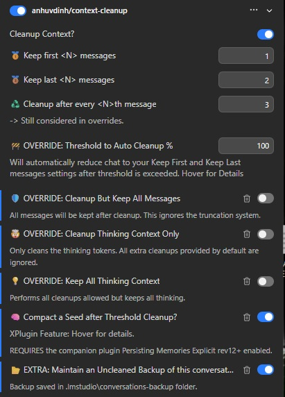

# Context Cleanup Plugin for LM Studio

- **This Plugin** - [GitHub - Context Cleanup](https://github.com/anh-vudinh/LM-Studio_Context-Cleanup) | [LMStudio](https://lmstudio.ai/anhuvdinh/context-cleanup)

- **Optional Compatible Plugin**
  [GitHub - Persisting Memories Explicit](https://github.com/anh-vudinh/-anh-vudinh-LM-Studio_Plugin-Persisting-Memories-Explicit) | [LMStudio](https://lmstudio.ai/anhuvdinh/persisting-memories-explicit) 
  
  *The [PM standalone model dependent version](https://lmstudio.ai/anhuvdinh/persisting-memories) has been **DEPRECATED** and it's tool call abilities have been merged as an alternative feature within the explicit version. Starting from LMStudio Rev 8 and Github v4.0, this plugin will no longer be compatible with the Persisting Memories model dependent(original) version LMStudio Rev 12 and Github v4.0*

- Tested working on Windows 11 Pro 25H2 - LM Studio 0.4.26
(Pathing is relative and nothing should be hardcoded specifically for windows, this should work with linux and macOS too.)

## Introduction

The **Context Cleanup** plugin gives users real-time control over auto trimming the amount of conversation history that stays tied up during a chat session, without them having to manually prune old turns or wait for the threshold where LM Studio determines the context window is full enough to begin truncation. This plugin accomplishes this by using the prompt preprocessor hook and maintaining the respective conversation file so only relevant information stays loaded — freeing up portions of the context window that was consumed by irrelevant and duplicated data in the past turns.

In addition, a cross plugin feature with my [PM-E plugin](https://lmstudio.ai/anhuvdinh/persisting-memories-explicit) can produce a compaction seed to store the truncated messages as a seed. These messages will be parted into multiple seeds which you can then convert into memory seeds and pull back into context if needed.

## Bug Fix (10/25/2026)
1. Backup conversation feature has been fixed. When testing it at inception I had my "cleanup after every nth message" set to 1 which always appeneded the lastest turn. Recalling memorires about the code and how I tested this feature back then I saw the problem and have fixed it along with updating it's logic to work with the new polling/polling method.

## New/Updated (10/25/2026)

1. Reworked this plugin to be polling/polling too like my PM-E plugin instead of polling/timeout. Now if you spam messages it can "catch up" when you eventually give it that 2 second grace period.

2. Optimized unresolved turns to one single write action. Because this plugin can now recover by "catching up", all preivous operations only happen on the final state of the conversation, each unresolved cleanup function is discarded (but leaves their presence in a queue) until the last operator gets the signal to execute. All features have been reworked to be capable of handling this new polling/polling + queue method. (sounds simple but was a real headache )

3. Double checked my code for any hard coded paths for Windows. Seems like there was no problems to begin with and this plugin should work for all OSes and if you're not using the default .lmstudio directory location.

4. QOL: Gave the save command lock out an early exit. Originally during a save command, truncation would be disabled until it was completed or you intentionally typed `exit save memory`. Now after 3 turns regardless if you have yet to resolve the save memory command, truncation will begin again.

5. QOL: Gave many read/parse/directory paths retries or fallbacks.

6. QOL: Added emojis and better tooltips to the Plugin Control Panel. Hover for tooltips.

7. If the 🧠 **Compact a Seed after Threshold Cleanup** Feature is enabled, Context Cleanup will append a warning to let users know the next turn will begin with a delay due to PM-E creating a compaction seed. I tried having the model give the warning to reduce the extra step of having the backend issue the warning, but models after seeing the request so often would establish a pattern and just have fun appending hallucinated compaction warnings with every reply they gave.  My first try was having this process in the background disjointed from the main flow, the problem was that if creating the compaction too over 17 seconds in the background and you're not actively keeping the chat session "awake" LM Studio would naturally disconnect plugins after it deemed the user as "idle". This would also kill the compaction creation process mid way.
  

  
Click to expand image of compaction warning

  
  

## Table of Contents

- [Overview](#overview)
- [Setup](#setup)
- [Typical Workflow](#typical-workflow)
- [How It Works](#how-it-works)
- [Technical Details](#technical-details)
- [Limitations or Notes](#limitations-or-notes)

## Overview

Every conversation you have in LM Studio is stored as a `.conversation.json` file. As your chats grow, these files accumulate metadata and older turns that keep getting resent to the model on every message — consuming your context window. This plugin steps in to clean up those conversation files behind the scenes.

On each trigger it performs several passes of housekeeping:

- **Truncation:** – Keeps a configurable number of the oldest and newest user and assistant messages, discarding everything in between that is no longer needed for an ongoing response. 
If you wish not to lose an assistant response out of context, you have three options: 
  1. widen the range of kept messages, 
  2. override cleanup but keep all messages, or 
  3. use my [GitHub - Persisting Memories Explicit](https://github.com/anh-vudinh/-anh-vudinh-LM-Studio_Plugin-Persisting-Memories-Explicit) to save an assistant's response into a memory seed. I highly encourage you to check this plugin out. You can also give your model the ability to pull up those "memory seeds" to reference or extract past data you've stored.

- **Thinking cleanup:** – Removes previously generated thinking steps from assistant messages so reasoning tokens aren't re-sent forever. The last assistant thinking is excluded and preserved.

- **Field cleaning:** – Blanks or strips leftover Jinja templates, prediction system prompts, past prediction tools, and preprocessed content blocks that are irrelevant after a turn has finished. Your current turn will always resend them, and the past ones just serve as irrelevant metadata taking up space.

- **Metadata preservation for my plugins:** – Carries over critical information such as the Internal Chat ID (`ICID`), any memory seeds from the companion plugin [GitHub - Persisting Memories Explicit](https://github.com/anh-vudinh/-anh-vudinh-LM-Studio_Plugin-Persisting-Memories-Explicit), and reorders the message # appended so it's always accurate after truncation.

- **Optional Backup:** The plugin can additionally create and maintain an unaltered backup of the conversation file. Those backups will be stored in `~/.lmstudio/conversations-backup`. If you ever wish to restore them it's as easy as creating a new chat session and then copy/pasting the backup contents into that corresponding conversation file.
  
- **Overrides:** There are optional overrides that users may find useful to customize their experience.

## Setup

From the LM Studio Website: Install from the LM Studio Hub and enable the plugin.

From GitHub Source Code: Open PowerShell or terminal, navigate to the root folder of the plugin (where you see the README, package, and manifest). Enter `lms dev -i -y`. The plugin should now be available in LM Studio.

Make sure **`Cleanup Context?`** is enabled alongside enabling the plugin — cleanup won't run at all if this is off.

Choose your options. The plugin will start working immediately after you send a message. Three turns must exist before the plugin begins cleaning. The OVERRIDES take precedence over the default plugin's workflow.

## Typical Workflow

1. **Enable the plugin** in LM Studio's plugin control panel.

2. **Configure your options** using the control panel — decide how many oldest/newest turns to keep and how often cleanup should run. [How It Works](#how-it-works).

3. **Have a conversation as usual.** Each new user message is added to history exactly like normal; you won't notice any difference on your end.

4. **Let the plugin do its work automatically.** There is a queuing system now so that users do not have to intentionally give the 2 second grace period every turn for cleanup to be resolved. Eventually when users do give the 2 second grace period, the past unresolved turns will be resolved together to clean up and maintains the current conversation file.

5. **(Optional) Enable backup mode** to keep an uncleaned copy of your conversations for reference or recovery. If you enable this mid-conversation, the *first moment* you turn it on becomes the foundation of the backup's data. Leave it toggled on if you want the model to continue updating that respective backup file. The moment you turn it off, the newest message turn stops being appended.

6. **(Cross Plugin Feature) Create a compaction seed** with PM-E plugin to create a compaction seed similar to a memory seed, before truncation. This way the truncated parts can be pulled in as a memory for reference. This is different from the backup mode and how you can do with it is also different.

## How It Works

The table below outlines every available configuration in the control panel and explains what each one does:

| Control Panel Option | Type | Purpose |
| :--- | :--- | :--- |
| **Cleanup Context?** | Boolean · `ON / OFF` | Master switch that turns all cleanup behavior on or off. The plugin only functions while this is enabled. |
| 🥇 **Keep first `<N>` messages** | Numeric · `min 1` | Number of oldest user/assistant turns to preserve from the beginning of the conversation. Message 1 will never be an option to remove. |
| 🥉 **Keep last `<N>` messages** | Numeric · `min 1` | Number of newest user/assistant turns to keep. |
| ♻️ **Cleanup after every `<N>`th message** | Numeric · `min 1` | Trigger rate of cleanup after the `<N>`th message from the last cleanup. Cleaning only begins once at least three existing messages are present (the current turn counts toward this). The OVERRIDES below still take precedence. |
| 🚧 **OVERRIDE: Threshold to Auto Cleanup %** | Numeric · `min 50, max 100 · OFF 90-100` | Signals when this plugin should automatically trigger a truncation. ***100% means OFF***. Messages will be Truncated down to the settings of Keep first <N> message and Keep last <N> messages. *Due to external constraints, context window will be reduced to 0 tokens used after truncation, this will be inaccurate and will be corrected to the correct tokens used after a new user message is sent.* |
| 🛡️ **OVERRIDE: Cleanup But Keep All Messages** | Boolean · `ON / OFF` | When enabled, internal cleaning still runs but no turns are truncated — everything is retained in context. This overrides the keep-oldest / keep-newest counts system. |
| 🤯  **OVERRIDE: Cleanup Thinking Context Only** | Boolean · `ON / OFF` | Restricts cleanup to thinking tokens only; all other default cleanups (system prompt, Jinja templates, tools, preprocessed content) are ignored. |
| 💡 **OVERRIDE: Keep All Thinking Context** | Boolean · `ON / OFF` | Disables thinking cleanup. All thinking will remain. Other cleanups still apply. |
| 🧠 **Compact a Seed after Threshold Cleanup** | Boolean · `ON / OFF` | Requires the Persisting Memories EXPLICIT Plugin: Creates a copy of the messages array before truncation to pass along to the PM-E plugin. The PM-E plugin will then create a compaction seed at the beginning of the next turn after the warning message. |
| 📂 **EXTRA: Maintain an Uncleaned Backup** | Boolean · `ON / OFF` | Keeps a backup copy of the conversation in `~/.lmstudio/conversations-backup`. The first time it is enabled, an exact 1-to-1 copy is saved; afterward only the latest user + assistant turns are appended to upkeep the current state. Requires truncation to trigger. |

**Multiple OVERRIDES are allowed to be enabled at the same time:**

🛡️ **OVERRIDE: Cleanup But Keep All Messages** + 🤯  **OVERRIDE: Cleanup Thinking Context Only** + 💡 **OVERRIDE: Keep All Thinking Context** = All messages and thinking kept, no other cleaning occurs.

🛡️ **OVERRIDE: Cleanup But Keep All Messages** + 🤯  **OVERRIDE: Cleanup Thinking Context Only** = All messages kept, only thinking is cleaned up.

🛡️ **OVERRIDE: Cleanup But Keep All Messages** + 💡 **OVERRIDE: Keep All Thinking Context** = All messages kept, everything other than thinking is cleaned up.

🤯  **OVERRIDE: Cleanup Thinking Context Only** + 💡 **OVERRIDE: Keep All Thinking Context** = No cleanups are performed. They cancel each other out. CTCO tries to clean up thinking and save the rest. KATC tries to clean up the rest but keep thinking. Neither allows the other to operate.

🚧 **OVERRIDE: Threshold to Auto Cleanup %** will override the ♻️ **Cleanup after every `<N>`th message** = no messages will be truncated until you have passed the threshold set for the context window.

## Technical Details

The plugin relies on LM Studio's local storage layout and manages a few files/folders automatically as part of its operation:

| Path / File | Role in Cleanup |
| :--- | :--- |
| **USER MESSAGE 1** | The first user's message is used to house metadata from my [GitHub - Persisting Memories Explicit](https://github.com/anh-vudinh/-anh-vudinh-LM-Studio_Plugin-Persisting-Memories-Explicit) plugin. This includes the ICID, memories the user injects, and formatting instructions. You can freely delete the user's message 1 — there is built-in recovery so nothing will break. This is just for your information; nothing is required of you on this front. |
| `~/.lmstudio/conversations` | The default main directory that LM Studio stores current chat sessions in. This is where the plugin reads, cleans up, and maintains conversation files. |
| `ChatSessionConversationRelationship.json` *(inside `/conversations`)* | Automatically created and used by this plugin. Tracks the mapping between an Internal Chat ID (`ICID`) and its matching conversation file so the plugin can reliably and cheaply locate the correct session across restarts or random uncontrollable plugin reinitializations. Hard cap of only 15 of the latest entries to keep the file size small. |
| `<conversationFile>.lock` *(temporarily inside `/conversations`)* | A temporary lock file created while cleanup is in progress and removed when finished. This lets this plugin safely run alongside others, such as my Persisting Memories Explicit plugin, that may want to modify the conversation at the same time. |
| `~/.lmstudio/conversations-backup/` *(only if createBackup is enabled)* | Holds uncleaned backup copies of your conversation. The first time it's enabled, an exact copy is saved; subsequent runs append only the latest uncleaned user/assistant turns to update the current state without constantly overwriting with a cleaned conversation and losing older chats. Old backup files whose names are reused for a new conversation will be renamed with the current time's UNIX timestamp as a suffix. The most recent conversation has priority over any duplicated base file name. |
| `<conversationFile>.persisting-memories-final-write.ready` *(temporarily inside `/conversations`)* | Created by my Persisting Memories Explicit plugin to coordinate with the Context Cleanup plugin, allowing Persisting Memories to signal to the Context Cleanup Plugin when it has finished. PM creates the `.ready` file; CC consumes it. |
 `<conversationFile>.copy` *(temporarily inside `/conversations`)* | This copy file will only be made if you are using the compact a seed feature. It is made for the Persisting Memories Explicit Plugin to consume. Context Cleanup is just the creator of the file. This feature requires PM-E + threshold auto cleanup ON + Compact a Seed ON |

## Limitations or Notes

- Just like my Persisting Memories plugin, this plugin must also respect the 2-second time window after the assistant has finished its response before any modifications to the conversation file / chat session stick and don't get overwritten by a cached version. This 2-second window is very short — you won't even notice it. With my new implementation of the queue system even if you don't wait, any unresolved turns will join a queue and be resolved whenever the 2 second opportunity happens.

- The plugin will not be able to delete the user's first message, but that does not prevent you from deleting it using LM Studio's standard "Delete this message" button tied to each chat bubble. Although I recommend the first user message be left alone if you don't want to. I've gone ahead and added the ability for the plugin to repopulate that metadata on its own in the user's new "first message." I've covered many failure points with recovery built in — just do what you wish to do how you wish to do it.

- Because there's not a way to monitor or predict the token value real-time, the value can only be checked after a turn is already resolved. This means that token related backend calculations are delayed by a turn. To compensate I limited the upper auto cleanup threshold to 89% and took a proactive approach to initiating truncation 1% earlier than the requested threshold. Tokens used value is also artificially reset to 0 after any truncation occurs. This way the new turn does not retrigger functions based off an old value. LM Studio's natural flow is that token count will be reassessed at the beginning and end of every turn, so this will naturally update your token count real-time. It's not actually 0 tokens used.